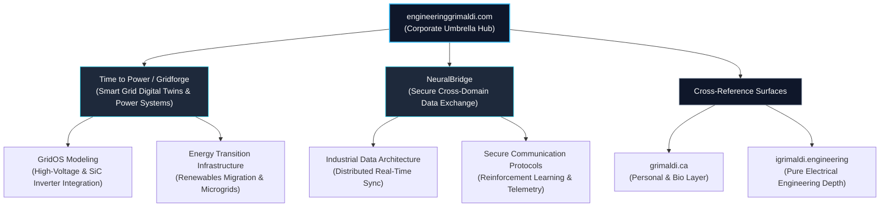

# ⚡ engineeringgrimaldi.com

### **Corporate Umbrella & Venture Portfolio**
*The strategic parent surface uniting industrial power systems intelligence and secure cross-domain data infrastructure.*

[Explore Live Surface](https://engineeringgrimaldi.com) • [Personal Surface](https://grimaldi.ca) • [Electrical Depth](https://igrimaldi.engineering)

---

> *"Infrastructure is the silent architecture of civilization."* — The foundational thesis driving the engineering ventures housed within this corporate ecosystem.

---

## 🌐 Ecosystem Architecture

The Grimaldi engineering presence is structured across three specialized domains, ensuring a clean separation between corporate governance, deep electrical physics, and human narrative.

| Layer | Surface | Core Focus & Role |
| :--- | :--- | :--- |
| **Corporate Hub** | **[engineeringgrimaldi.com](https://engineeringgrimaldi.com)** *(This Repo)* | Parent umbrella for **Time to Power / Gridforge** and **NeuralBridge** |
| **Electrical Depth** | [igrimaldi.engineering](https://igrimaldi.engineering) | High-voltage grids, silicon carbide inverters, machines, and physics-informed methods |
| **Personal Surface** | [grimaldi.ca](https://grimaldi.ca) | Biography, broader ambitions, writing, podcast, selected projects, and direct contact |

---

## 🏢 Venture Portfolio

`engineeringgrimaldi.com` acts as the definitive command center and gateway for our core technology ventures:

### 1. Time to Power / Gridforge

* **Focus**: Intelligent electrical grid solutions, high-voltage direct current (HVDC) distribution optimization, silicon carbide (SiC) inverter analytics, and grid stability digital twins (`GridOS`).
* **Target Impact**: Accelerating the renewables migration, stabilizing modern power transmission, and equipping grid operators with real-time simulation and predictive control.

### 2. NeuralBridge

* **Focus**: Cross-domain data exchange frameworks, secure telemetry protocols, reinforcement learning architectures, and synchronized industrial information flows.
* **Target Impact**: Eliminating data silos between mission-critical physical systems, enterprise software, and automated control loops.

---

## 🎯 Target Audience & Navigation Guide

Designed for enterprise partners, institutional investors, system architects, and technical collaborators:

* **For Corporate Partnerships & Venture Inquiries** → Explore this hub and route directly to [Time to Power / Gridforge](https://www.google.com/search?q=https://timetopower.ai) or [NeuralBridge](https://neuralbridge.io).
* **For Deep Electrical Physics & Mathematical Modeling** → Access specialized technical papers and device architectures at [igrimaldi.engineering](https://igrimaldi.engineering).
* **For Direct Collaboration, Bio, and Personal Context** → Visit [grimaldi.ca](https://grimaldi.ca).

---

## ⚡ Technical Stack & Architecture

Engineered for maximum reliability, velocity, and pristine visual presentation:

* **Framework**: [Next.js](https://nextjs.org/) (App Router, static & dynamic rendering optimization)
* **Language**: [TypeScript](https://www.typescriptlang.org/) for robust enterprise type safety
* **Styling**: Modular Tailwind CSS architecture
* **Deployment**: Edge-accelerated via [Vercel](https://vercel.com)

---

## 📬 Corporate & Venture Contact

* **Corporate Hub**: [engineeringgrimaldi.com](https://engineeringgrimaldi.com)
* **Primary Email**: [vincenzo@igrimaldi.engineering](https://www.google.com/search?q=mailto%3Avincenzo%40igrimaldi.engineering)
* **Base of Operations**: Frankfurt am Main, Germany

---

### **Governance & License**

Code: [MIT](https://www.google.com/search?q=LICENSE) • Intellectual Property & Content: All rights reserved.

*Engineering the backbone of future energy and data infrastructure.*
